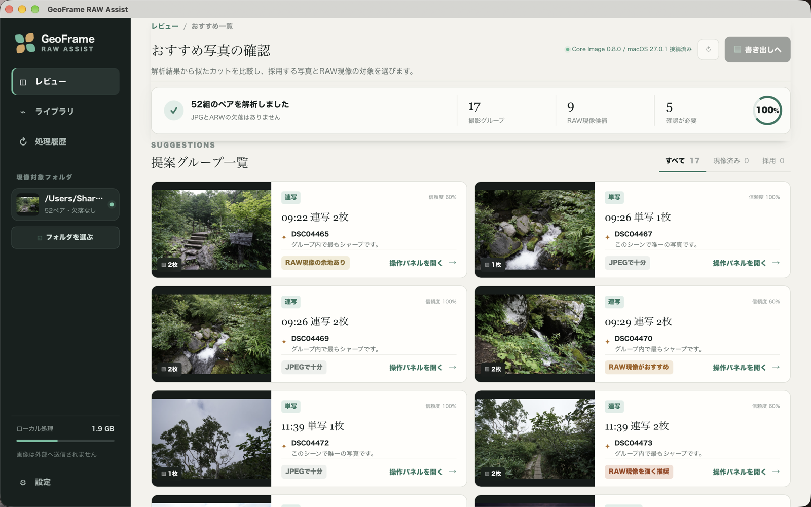

# GeoFrame RAW Assist

**旅行写真の JPEG+RAW から、現像する価値のあるカットを選んで仕上げる。**

Sony α で撮った JPEG と ARW の同名ペアを解析し、似たカットを撮影グループにまとめて代表を選び、RAW 現像が効く写真を推薦する macOS のデスクトップアプリです。プリセットとスライダーで現像し、ブラケット撮影は 1 枚に合成し、選んだ写真を書き出して Apple「写真」に登録できます。

**紹介ページ(LP): https://ysogabe.github.io/geoframe-raw-assist/**



## できること

- **撮影グループにまとめる**: 撮影時刻・レンズ・焦点距離から、連写・ブラケット・類似・単写のグループを作り、代表カットを選びます。
- **RAW 現像の価値を推薦する**: 白飛び・黒つぶれ・高 ISO などから、RAW 現像を「強く推奨」「推奨」「検討」「JPEG で十分」の 4 段階で示します。
- **11 種のプリセットで現像する**: 風景・夜景・夕景・逆光・モノクロなどから選び、スライダーで調整します。プレビュー（長辺 2400px）で確かめてから原寸で本現像します。
- **ブラケットを 1 枚に合成する**: 露出を変えて撮った 2〜9 枚を位置合わせして、Exposure Fusion で白飛びと黒つぶれを抑えた 1 枚にします。
- **現像の候補を自動で作る**: 縮小した代理画像で調整値を探索し、「自然」「低ノイズ」「SNS 向け」などの候補を指標つきで示します。選ぶのは人です。
- **EXIF を引き継いで書き出す**: 本現像と本合成の JPEG に、ペアのカメラ JPEG の EXIF を引き継ぎます。元の JPEG に GPS があれば残ります。
- **Apple「写真」に登録する**: 書き出したバッチをアルバムにまとめて「写真」アプリへ取り込みます。

## 動作環境

macOS 専用の Apple Silicon 向けアプリです（DMG は aarch64）。`tauri.conf.json` の最小 macOS は 14.0 ですが、動作を確認しているのは macOS 27.0.1 / Apple M3 だけで、対応 OS は最新の macOS を想定しています。

対応する写真は、Sony α の既定の命名（`DSC02943.JPG` と `DSC02943.ARW`）の JPEG+ARW 同名ペアです。他メーカーや他の命名は確認していません。

1 つのフォルダの直下に、次のように同名のペアを置きます（サブフォルダは見ません）。アプリにサンプル写真は同梱していないので、最初にフォルダを選びます。

```
<選んだフォルダ>/
├── DSC02943.JPG
├── DSC02943.ARW
├── DSC02944.JPG
└── DSC02944.ARW
```

配布用の署名・公証済みバイナリはありません（`tauri.conf.json` に署名設定はなく、Developer ID 署名と公証は未実施です）。ソースからビルドして使います。Xcode（Swift）、Rust、Node.js が必要です。手順は [使い方](docs/USAGE.md) にあります。

## いまの状態

v0.1.0 です。解析、グループ化と推薦、プレビュー・本現像、ブラケット合成、現像候補の生成、書き出し、「写真」への登録まで実装済みで、Python のサーバーに頼らない単一のアプリとして動きます。

未確認・今後のこともあります。

- 露出ブラケット合成は、実際の AEB や三脚での長秒ブラケットでの画質確認が終わっていません。
- 現像候補は縮小した代理画像での評価で、美的な正解や最終的な RAW 品質を保証しません。
- 現像エンジンの `apple_default` は内部パラメータが非公開で、macOS の更新で画が変わりえます。更新後の回帰確認手順があります。
- 本現像と合成は完了まで画面で待ち、途中でキャンセルできません。
- HDR、連写の選好学習、パノラマ、参照プリセットは予定の段階です。

元の JPG と ARW は、どの操作でも変更しません。生成物はアプリのデータフォルダ（`~/Library/Application Support/com.geoframe.rawassist/`）に保存します。

## 使う・開発する

ビルド、写真の置き場所、操作の流れ、うまくいかないときの確認、テストの実行は [使い方](docs/USAGE.md)、内部の構成は [技術設計](docs/DESIGN.md) にまとめています。文書の一覧は [Docs](docs/README.md)、紹介ページの更新と公開手順は [LP の管理](docs/LP.md) を参照してください。

最短の起動手順は次のとおりです（事前に Xcode、Rust、Node.js 22.13 以上を用意します）。

```bash
npm install
env -u CI npm run tauri:dev
```

配布形の `.app` と DMG を作るときは `env -u CI npm run tauri:build` を使います。

`tauri:dev` と `tauri:build` は、Core Image の現像 CLI を先に自動でビルドします。環境変数 `CI` が設定されていると tauri CLI が失敗することがあるため、`env -u CI` を付けています。

## リポジトリの構成

| ディレクトリ | 中身 |
|---|---|
| `src/` | 画面。React + Vite + Tailwind で、Tauri の WebView 内で動きます |
| `src-tauri/` | アプリ本体（Rust）。解析、現像の指示、書き出し、EXIF 継承、候補探索を担い、Tauri コマンドで画面とつながります |
| `native/coreimage-cli/` | Core Image の現像 CLI `geoframe-ci-develop`（Swift）。Tauri の externalBin としてアプリに同梱されます |
| `scripts/`、`tests/` | 評価用の Python スクリプトとそのテスト。アプリの実行には使いません |
| `docs/` | 使い方、技術設計、API 契約、設計判断（ADR）、計測レポート |
| `site/` | 紹介ページ（LP） |

Tauri は、画面を表示する WebView 側（`src/`）と、OS の機能にアクセスするネイティブ側（`src-tauri/`）を別々に持つ構成のため、どちらも必要です。ファイルの読み書きや外部プロセスの起動は本体側が行い、画面は Tauri コマンドを呼んで結果を受け取ります。

## ライセンス

MIT ライセンスです。[LICENSE](LICENSE) を参照してください。
